# HEARTH visual handover for the artist, 2026-11-13

> - This is the brief for an AI-assisted visual artist (ComfyUI / SDXL plus paint-over) who redraws the visual content of HEARTH — Merge & Mystery.
> - Scope: 984 existing assets to redraw or review plus 186 new assets, 1,170 rows in `docs/visual-handover-asset-checklist.csv`.
> - The style is locked. You raise fidelity and consistency; you do not change the look.
> - You deliver static art for everything, plus a short list of key animations.
> - Start with the WP0 test batch. Nothing else begins until it is approved.

## 1. The game in one paragraph

HEARTH — Merge & Mystery is a cozy merge-story wellness game. Real-world actions (steps, sleep, sunlight, meditation, kindness) generate the game's energy, and that energy restores the storm-wrecked seaside village of Emberhollow. It is a portrait phone game; the app is at most 440 CSS px wide. The mood is "coming home after a good day", and warmth stands for progress. Energy is never sold: there are no in-app purchases, no gems and no ads.

## 2. Style lock

These rules are not negotiable.

- Hand-painted storybook illustration with soft painterly brushwork, visible brushstrokes and a faint paper texture. It is not flat vector, not a 3D or CGI render, not cel-shaded anime and not photoreal.
- Warm amber key light from the upper left, dusk-blue fill, gentle rim light.
- Camera: a slightly top-down 3/4 view for buildings and props (the style guide calls it 45-degree isometric). Characters are in 3/4 view.
- Dark navy ground with gold leading. Teal is support only. Saturation is moderate.

| Name | Hex |
| --- | --- |
| navy-0 | #0d1322 |
| navy-1 | #0f1626 |
| navy-2 | #16203a |
| panel | #1b2138 |
| panel-2 | #232a45 |
| parchment | #ecdcb6 |
| parchment-2 | #d9c496 |
| cream | #f4ecd8 |
| ink | #3a2817 |
| wood | #6b4a2a |
| ember | #f4a63b |
| ember-hi | #ffd27a |
| ember-deep | #e5761e |
| gold-edge | #b06a1e |
| terracotta | #b5623a |
| sea | #4f8698 |
| teal | #3f7d88 |
| teal-hi | #6fb6c4 |
| teal-deep | #235058 |
| olive | #7d8a4f |

The master illustration palette from the style-lock guide is #EAD7B5 #C79A6B #8FBF8F #6A8CA7 #8E7CC3 #D46B6B #F4F0E6.

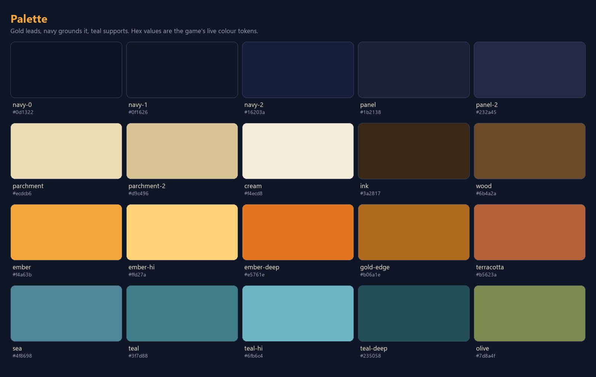

Hard bans:

- No gems, diamonds or any premium-currency art.
- Energy is an ember-heart or flame, never a lightning bolt.
- Currency is a coin only.
- No text, labels, numbers or watermarks inside any image.
- No baked cast shadows. The game draws them.
- No painted sun disc in any island plate.
- No ads or urgency imagery.

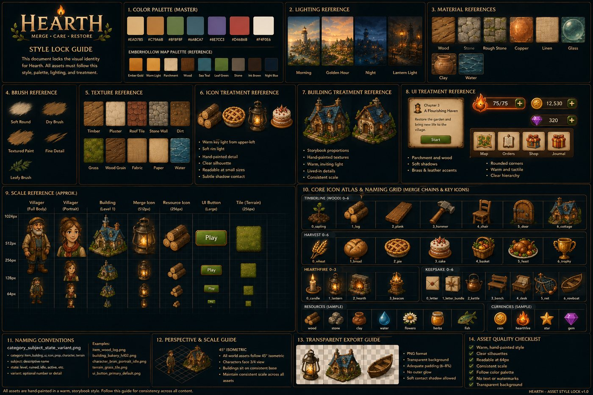

The style-lock guide predates two rulings. It shows a purple gem currency and text labels; ignore both.

**Style north star (Owner to confirm).** The shipped art is not one style. The building matrices (samples 01, 02 and 11) and the painted player portraits (sample 05, lower rows) are the newest work and are the target. Older sets drift. Villager busts are flatter and more cartoon than the player portraits. Merge items are cleaner and less textured than the buildings. The icon kit and several badges sit on unkeyed backgrounds. The redraw brings everything to the building and portrait standard.

## 3. What ships today

Each image below shows current art and what is wrong with it.

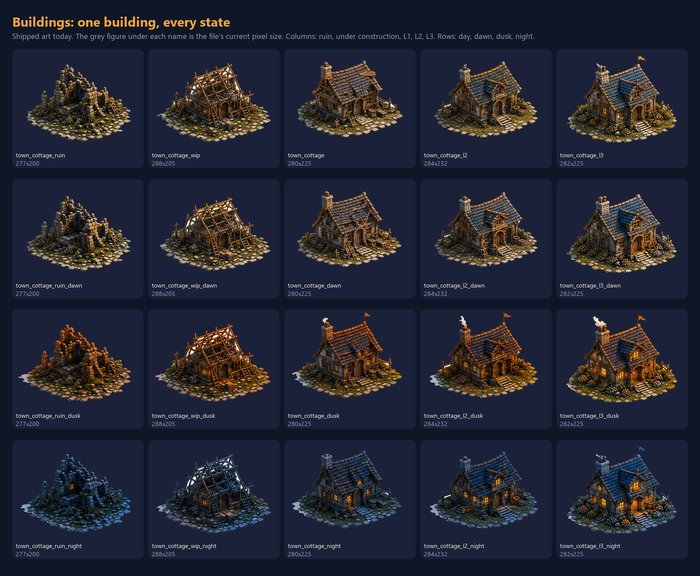

The Old Cottage in all five states (ruin, under construction, level 1, 2, 3) at four times of day (day, dawn, dusk, night). This 20-image set is the unit of delivery for a building. The sources are only about 280×225 px.

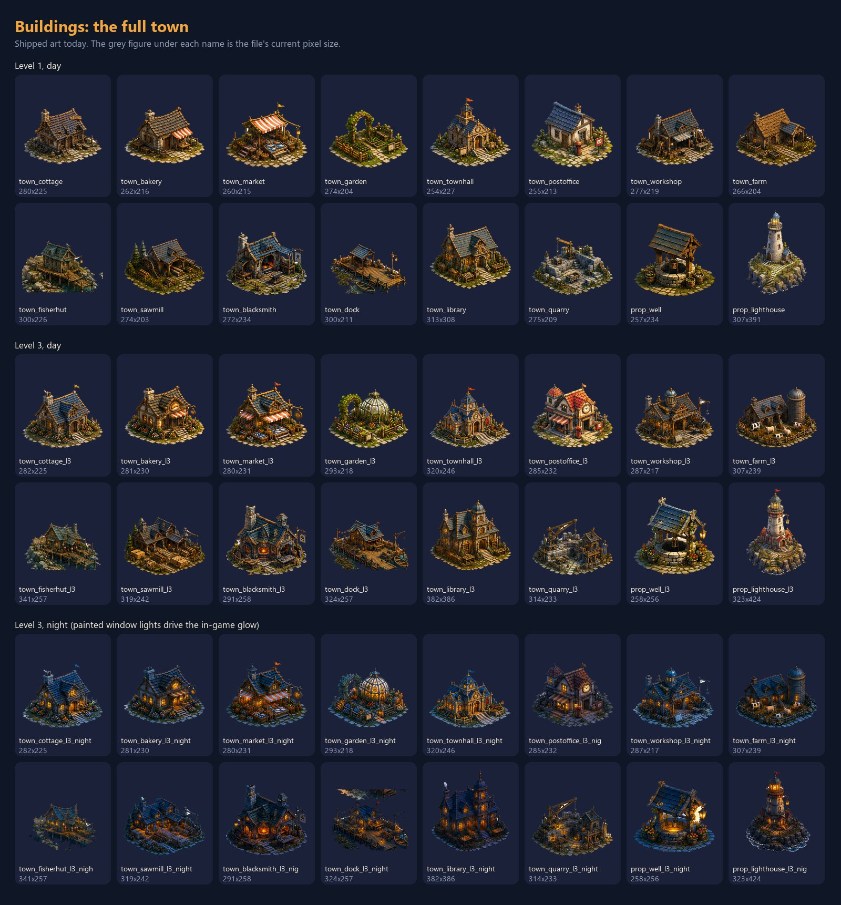

All 16 buildings at level 1 day, level 3 day and level 3 night. The painted warm window lights in the night sprites drive the in-game glow.

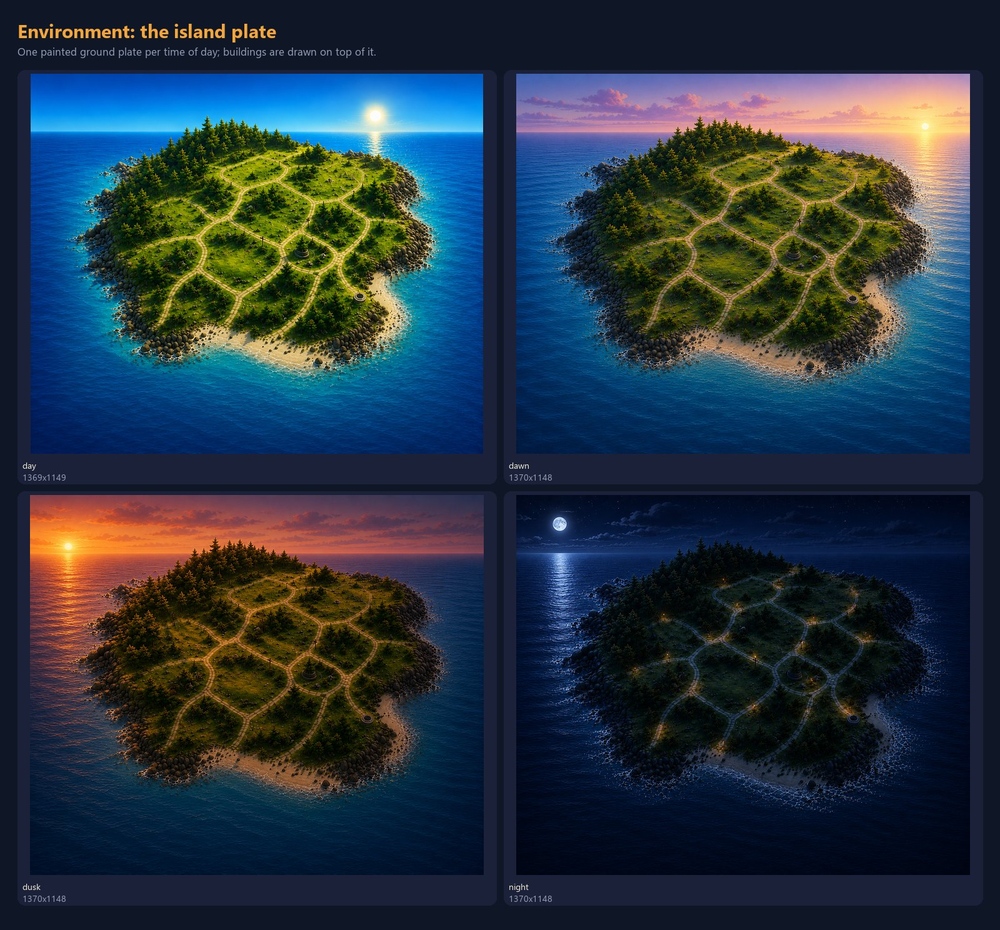

The painted island ground plate (1370×1148, opaque) at day, dawn, dusk and night. Buildings are drawn on top of it.

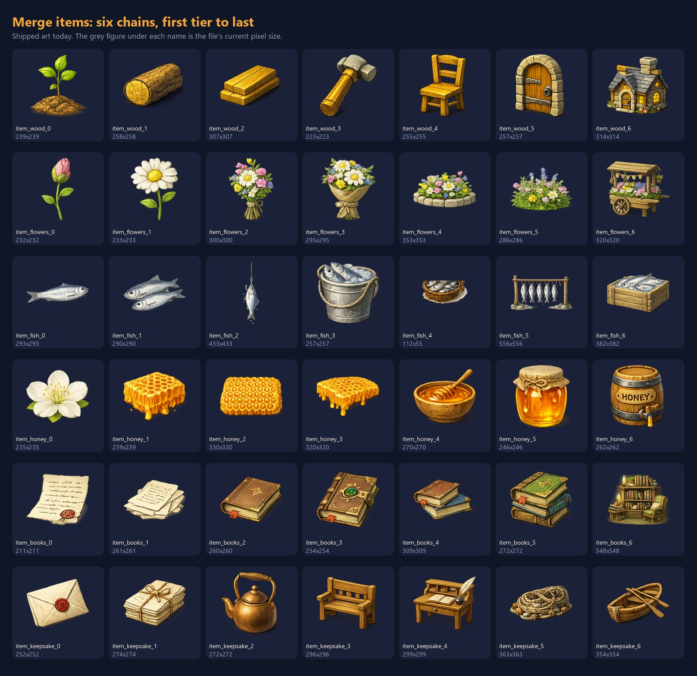

Six of the 20 merge chains (wood, flowers, fish, honey, books, keepsake). Sources vary from 112×55 to 595×595 with no consistent canvas. `item_fish_4` is 112×55. `item_honey_6` has the word HONEY painted on it, which breaks the no-text rule.

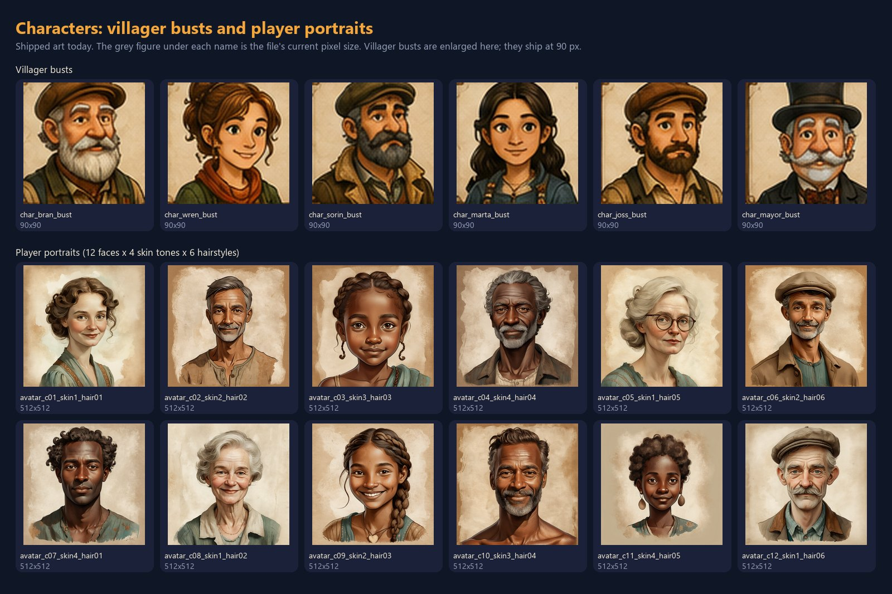

Six villager busts (shipped at 90×90, shown enlarged) and 12 of the 288 player portraits (512×512). The two sets do not match in style.

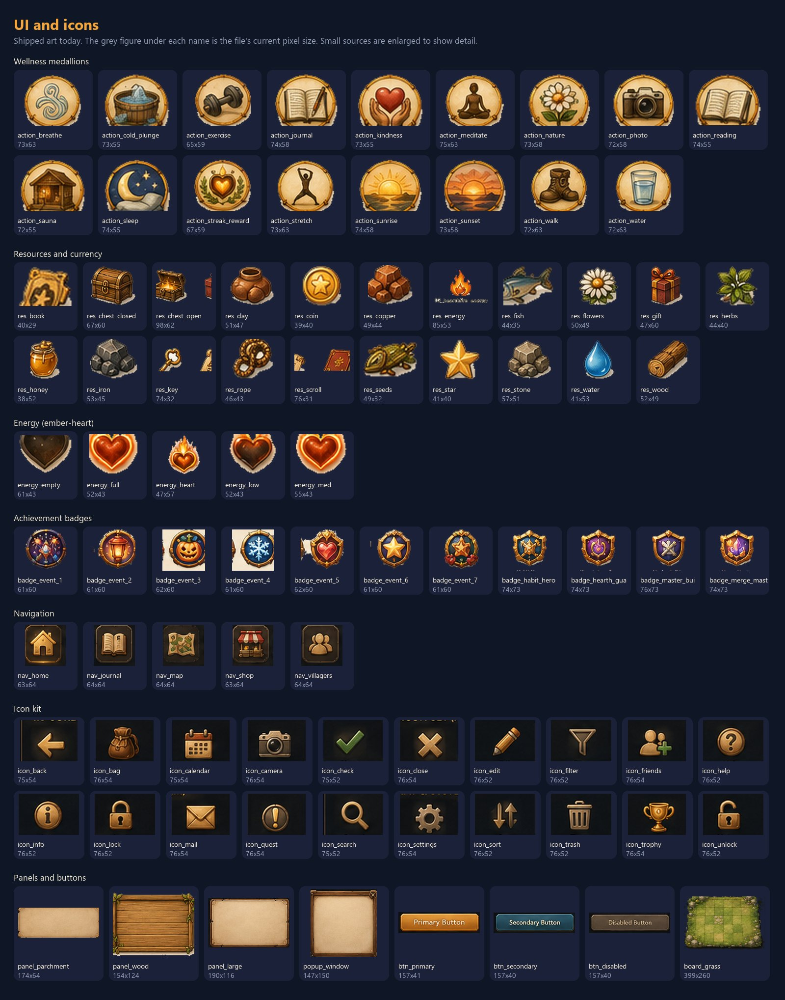

Medallions (about 73 px), resources (38–98 px), ember-heart energy states, badges, nav, the icon kit, panels and buttons. `res_chest_open`, `res_key` and `res_scroll` include slices of a neighbouring sprite. `res_energy` has text baked in. `badge_event_3`, `badge_event_4`, `badge_event_5` and the whole `icon_*` kit sit on unkeyed backgrounds. Panel and button art has placeholder text.

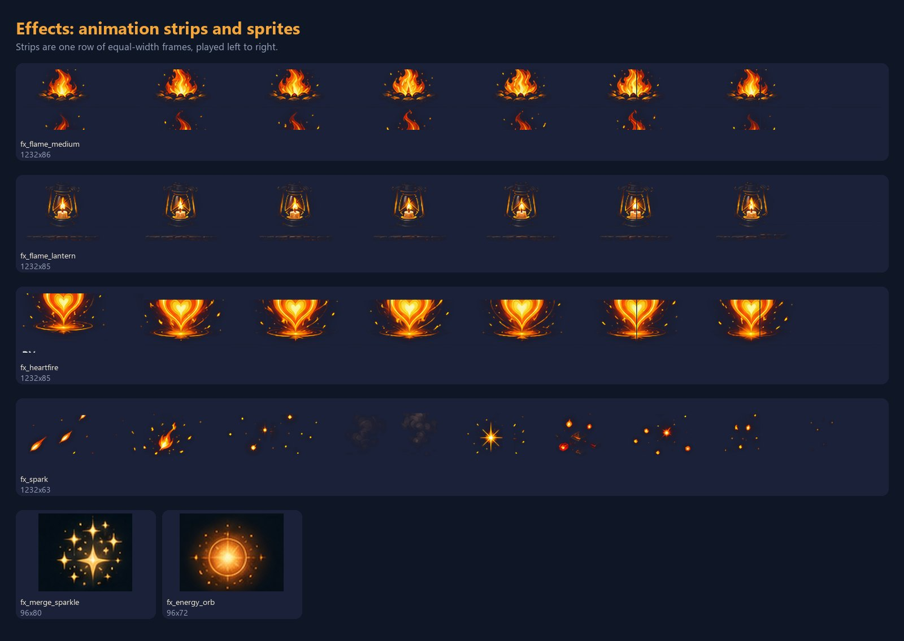

Animation strips (7 frames in one row, most of them 1232 px wide) and two effect sprites. `fx_flame_medium` carries a second row of flames from the source atlas. Frames have seam lines. The `fx_spark` frames are unrelated sparks, not one animation. `fx_merge_sparkle` and `fx_energy_orb` have opaque dark backgrounds.

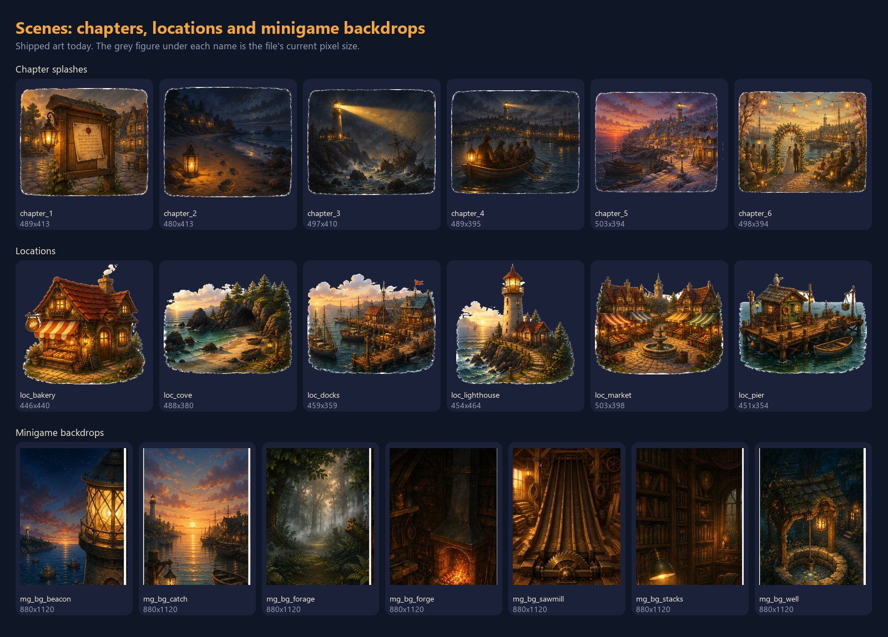

Chapter splashes (about 500×410), location art (about 460×400) and minigame backdrops (880×1120, opaque).

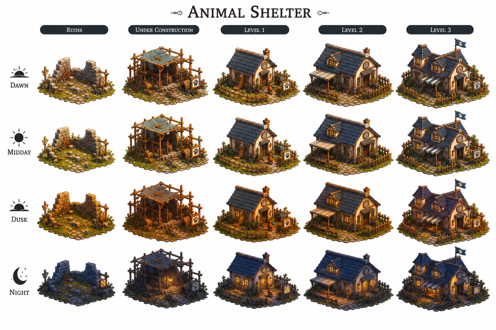

The Animal Shelter matrix. This building is not in the game yet. It is the model for how a building set is delivered.

## 4. AI workflow

A locked ComfyUI building workflow exists at `tools/comfy_workflows/hearth_building_LOCKED_api.json`. Its settings:

- Checkpoint RealVisXL_V5.0.
- ControlNet canny SDXL, strength 0.95, end 0.72, with the edge map taken from the reference cell.
- IPAdapter `ip-adapter-plus_sdxl_vit-h` at weight 0.45, conditioned on a matted guide board of approved buildings.
- Sampler dpmpp_2m with the karras scheduler, 40 steps, CFG 7.0.
- Latents about 1024 px wide. Per state: ruin 1024×840, wip 1024×832, L1 1024×848, L2 1024×808, L3 1024×792.

Positive style prefix to reuse:

```text
game asset, warm hand-drawn storybook illustration, confident visible ink and pencil linework over soft painted colour, clearly hand-illustrated NOT a digital render, NOT photoreal, NOT a 3D game asset render, NOT CGI, gentle rim light, palette #EAD7B5 #C79A6B #8FBF8F #6A8CA7 #8E7CC3 #D46B6B #F4F0E6, 45-degree isometric view, {SUBJECT}, standing on its own small cobblestone plinth with a thin edge of moss and grass, plain uncluttered neutral grey backdrop, single subject, small and centred with an even ~10% empty margin on all four sides
```

Negative prompt core:

```text
flat vector, sterile, 3d render, cgi render, plastic, oversaturated, photograph, diorama, miniature model, toy, unreal engine, octane render, modern architecture, photoreal, hyperrealistic, people, characters, extra structures, multiple buildings, cropped, low quality, sky, clouds, background scenery, gradient background, vignette, ground plane, drop shadow, close-up, touching edge of frame, text, watermark, signature, flat cel-shaded anime, manga
```

Scenes and plates share this style clause:

```text
hand-painted digital illustration, soft painterly brushwork, visible brushstrokes, muted earthy old-seaside colour palette, driftwood brown cream sage muted teal rust, children's book illustration style
```

For the neutral base plate, add `gentle even overcast daylight, soft diffuse light, no strong shadows, no sunset, no golden hour`. Scenes use RealVisXL_V5.0, dpmpp_2m with karras, 32 steps, CFG 7.0 and no IPAdapter.

Cut-outs: run rembg, then check the result on navy #0f1626 for fringing, and check that corner pixels are alpha 0.

The written recipe docs disagree with each other. `docs/comfy-building-worksheet.md` names Juggernaut-XL_v9 and a face IPAdapter. `docs/comfy-style-dialin.md` and the locked workflow file use RealVisXL_V5.0 and the plus adapter. The workflow file is the reference (Owner to confirm).

AI output is a starting point. Paint over it for consistency across a set: the same roofline, door, chimney and plinth through all five states of a building, and the same character across expressions. Remove AI artefacts such as melted windows, extra chimneys and garbled signage.

You may use your own tooling if the output passes the style gate (WP0).

## 5. Delivery contract

### Format

- PNG only. Sprites are RGBA with real transparency. Scenes (island plates, backdrops, story backgrounds, player portraits) are opaque RGB. sRGB, 8-bit.
- One file per asset id. The file name is the id plus `.png`, in lowercase snake_case, following the grammar `category_subject_state_variant`.
- The id is the contract. The game looks art up by file name and silently falls back (emoji, a placeholder or a hidden feature) when a file is missing.
- Leave 4–8% empty margin and centre the subject. No baked drop shadow; a soft contact shadow under a prop is allowed.
- World sprites (buildings, props, trees, decor) are anchored bottom-centre on the ground-contact line. Nothing sits below the base.

### Buildings

- Ids are `town_<name>` for level 1 day. State suffixes are `_ruin`, `_wip`, `_l2` and `_l3`. Time-of-day suffixes are `_dawn`, `_dusk` and `_night`; no suffix means day. That is 5 states × 4 times = 20 files per building.
- The four times of day of one state share one canvas and are pixel-registered, because the game crossfades them in the same rectangle. Different states may use different canvas sizes.
- Keep the footprint width consistent from state to state so the building does not jump when it upgrades.
- Accepted alternative: one matrix sheet per building, with 5 columns (ruin, under construction, L1, L2, L3) and 4 rows (dawn, midday, dusk, night) on plain white with clear gutters, as in sample 11. The repo's importer (`tools/import_map_v2.py`) splits it.
- Night sprites: paint lit windows and lanterns as saturated, warm, bright pixels. The game finds them and places the glow there.

### Island plate

The sea must stay clearly blue/teal-dominant and the land must not be, because the game detects water by colour. No sun disc. All time-of-day versions share one canvas and are pixel-registered.

### Animation

- One PNG strip: a single row of equal-width frames edge to edge, with no padding or gutters.
- RGBA, with alpha 0 at frame edges. The last frame flows into the first for loops.
- No Lottie, video or GIF.
- Tileable textures and particle atlases are seamless on all four edges and are not autocropped.

### Master sizes

| Category | Master size you deliver | What ships today |
| --- | --- | --- |
| Merge items | 512×512 | 112–595 px, inconsistent |
| Building cells | at least 1024 px wide per cell | about 250–380 px wide |
| Island plate | larger than 1370×1148; propose 2048 px on the long edge (Owner to confirm) | 1370×1148 |
| Villager busts | 512×512 | 90×90 |
| Player portraits | 512×512 opaque | 512×512 |
| Wellness medallions | 256×256 | about 73×58 |
| Resources, currency, energy | 256 px long edge | 38–98 px |
| Achievement badges | 256×256 | 61–76 px |
| Nav icons and weather glyphs | 128×128; must read as a silhouette at 26–30 px | 64×64 |
| UI icons | 128×128 | about 76×53 |
| Map props, nature, decor | 256–320 px long edge | 45–170 px |
| Minigame backdrops | 880×1120 opaque | same |
| Chapter and location art | 1024 px long edge | about 450–500 px |
| Story backgrounds | 1440×960 opaque | none exist |
| Screen headers | 1200×300 opaque | same |
| App icon | 1024×1024 | 512×512 |

A master is at least 4× the largest size the asset appears on screen. Deliver masters. Shipping sizes are produced on import, so do not optimise file size yourself.

### Folder layout

Each delivery uses `WP<n>_<name>/<id>.png`, plus the layered source (PSD or Krita) and, for AI-generated pieces, the workflow JSON and seed.

## 6. Work packages

| WP | Scope | Existing to redraw or review | New | Total |
| --- | --- | --- | --- | --- |
| WP1 | Buildings | 341 | 43 | 384 |
| WP2 | Environments | 66 | 48 | 114 |
| WP3 | Characters | 308 | 10 | 318 |
| WP4 | Merge items | 133 | 4 | 137 |
| WP5 | UI and icons | 108 | 34 | 142 |
| WP6 | Key animations | 12 | 31 | 43 |
| WP7 | Story and brand | 16 | 16 | 32 |
| Total |  | 984 | 186 | 1,170 |

`docs/visual-handover-asset-checklist.csv` is the authoritative id list. Its columns are `id`, `category`, `work_package`, `status`, `current_px`, `current_mode`, `current_kb`, `target`, `action` and `notes`. The `action` value is one of redraw, review, new, hold or retire.

Recommended order after WP0: WP1 and WP2(a) first, because they unblock the larger map and the weather system, then WP4, WP5, WP3, WP6 and WP7.

### WP0 Style-lock test batch (gate)

Before any volume work, deliver:

- One full building set: 20 files for `town_cottage`.
- One merge chain: 7 files, `item_wood_0` to `item_wood_6`.
- One villager bust, `char_wren_bust`, plus a check that it matches the player-portrait rendering.
- One medallion: `action_meditate`.
- The ember-heart energy states: `energy_empty`, `energy_low`, `energy_med`, `energy_full`, `energy_heart`.
- One flame strip: `fx_flame_medium`, 7 frames.

Nothing else starts until this is approved.

### WP1 Buildings

Counts: 341 existing, 43 new.

- 16 existing buildings × 20 files = 320: `town_cottage`, `town_bakery`, `town_market`, `town_garden`, `town_townhall`, `town_postoffice`, `town_workshop`, `town_farm`, `town_fisherhut`, `town_sawmill`, `town_blacksmith`, `town_dock`, `town_library`, `town_quarry`, `prop_well`, `prop_lighthouse`.
- New: `town_tailor` (20 files; the Tailor's Cottage is hidden in the game until its art exists) and `town_animalshelter` (20 files; the reference matrix is sample 11).
- Three late-game single buildings: `town_beacon_south`, `town_school`, `town_cottage_wed`.
- Five homestead stages, `stage_0` to `stage_4`.
- The 16 generic `town_ruin_0..7` and `town_wip_0..7` sprites are retired. Do not redraw them.
- `town_fisherhut` and `town_dock` stand in water. The game adds the reflection.
- On screen a building is 30–70 CSS px wide at default zoom and up to about 360 device px at maximum zoom. It must read as a silhouette when tiny and hold detail when zoomed.

Acceptance check: the full 20-file set registers pixel for pixel across times of day, keeps one footprint width across states, and passes the navy-background check at 1× and 4×.

### WP2 Environments

Counts: 66 existing, 48 new.

**(a) Island plate v3.** Larger than today's map, with the island grown to the west. A rocky cliff shoulder is cleared for the quarry and a fenced pasture or meadow is cleared for the animal shelter. Existing building plots keep their relative positions.

- `map_island_plate_v3`: neutral even daylight, no baked time of day.
- `map_island_plate_v3_night`: the lit-night version on the same canvas.
- `_dawn` and `_dusk` versions are needed only if painted phases are kept rather than graded in code (Owner to confirm).

**(b) Depth layers for the weather system.**

- `art_sky_strip`: tall sky.
- `art_far_band`: distant sea and headland, transparent top.
- `art_near_band`: foreground grass and rocks.
- `mask_depth_island`: greyscale, near to far.
- Sun-key overlays `light_key_se`, `light_key_s`, `light_key_sw`, then `light_key_e` and `light_key_w`.

**(c) Props.** 54 existing map props and nature sprites to redraw. New pieces:

- 8 beauty-decor pieces: `decor_fountain`, `decor_statue`, `decor_arch`, `decor_gazebo`, `decor_monument`, `decor_planter`, `decor_birdbath`, `decor_lantern_post`.
- Seasonal and festival props.
- Pier and shore pieces: `dock_pier_long`, `dock_pier_end`, `shore_transition_sand_a`, `shore_transition_sand_b`, `shore_transition_sand_c`.
- `town_market_awning` and `town_market_awning_furled`.
- `prop_firering` and `prop_firering_lit`.

**(d) Minigame backdrops.** 7 existing, plus new `mg_bg_bakery`.

Acceptance check: the plate keeps blue/teal-dominant sea and non-blue land, has no sun disc, and any extra versions register to the same canvas.

### WP3 Characters

Counts: 308 existing, 10 new.

- Villager busts at 512×512. Existing: Bran (baker), Wren (postmistress), Sorin (old keeper), Marta, Joss (boatswain) and the Mayor. New: `char_blacksmith_bust`, `char_fisherman_bust`, `char_librarian_bust`, `char_child_bust`, `char_pell_bust` (the tailor).
- Framing: chest-up, single figure centred, eyes about 35–40% from the top, warm and welcoming, frameless, matching the player-portrait rendering.
- Optional expression set per villager at the same framing: `_happy`, `_worried`, `_surprised`. The game does not use these yet.
- Player portraits: 288 exist (12 faces × 4 skin tones × 6 hairstyles). Review them for consistency and re-render only where a portrait drifts.
- The 6 legacy `avatar_1..6`: review.
- Full-body `npc_*` sprites (8 existing, 5 listed) are on hold. The game does not draw walking villagers today.

Acceptance check: a villager sits beside a player portrait with no visible jump in rendering style.

### WP4 Merge items

Counts: 133 existing icons, 4 new (the missing seaweed chain, `item_seaweed_0` to `item_seaweed_3`).

- There are 20 chains. Ids are `item_<chain>_<n>`, counting from 0.
- Seven tiers: wood, harvest, keepsake, stone, clay, seeds, flowers, water, copper, fish, honey, herbs, wool, books, music, apothecary. Four tiers: hearthfire. Five: homestead. Six: greenhouse and smithy.
- Every icon uses the same 512×512 canvas and the same margin, so a chain reads as one family and each tier is visibly "more" than the last.
- Icons appear at 45–60 CSS px on the board, so silhouette comes first.

Acceptance check: each chain, shown as a row at board size, reads as a progression.

### WP5 UI and icons

Counts: 108 existing, 34 new.

- 17 wellness medallions (`action_*`).
- 22 resources, currency and reward items.
- 5 energy states.
- The 20-icon kit (`icon_*`).
- 5 nav icons, plus new `nav_create`.
- 11 badges, plus 3 new (`badge_event_8`, `badge_event_9`, `badge_event_10`; proposed ids, because three achievements share a badge today).
- 7 new weather glyphs: `wx_clear`, `wx_clouds`, `wx_overcast`, `wx_fog`, `wx_rain`, `wx_storm`, `wx_snow`.
- `time_badge_evening`.
- HUD pieces: `ui_hud_bar` (1024×128, 9-slice friendly, left 120 px clear), `ui_hud_portrait_ring` (128×128, transparent centre) and `ui_hud_divider` (8×64).
- `avatar_frame`.
- Board frame `board_frame` (1080×1400) and seamless 256×256 turf tiles.
- 5 crests, 4 map markers, streak rewards and minigame sprites.
- Panels and buttons: no text on them, stretchable 9-slice with clean corners.

The game still shows emoji for some controls (zoom, decorate, lock, duel, close, hearts, stars). The icon kit replaces them once it is wired.

Acceptance check: everything is on real transparency, with no neighbouring-sprite slices, and nav and weather glyphs read as silhouettes at 26–30 px.

### WP6 Key animations

Counts: 12 existing, 31 new. Frame sizes below are the engine's current sizes. Deliver at 2× with the same frame count and aspect.

| Id | Frames × frame size | Notes |
| --- | --- | --- |
| `fx_flame_*` (tiny, small, medium, large, lantern, fireplace, forge, beacon) | 7 frames | 8 existing strips |
| `fx_heartfire` | 7 frames | existing strip |
| `fx_spark` | 7 frames | one coherent burst |
| `fx_flame_hearth` | 7 × 48×64 | |
| `fx_lantern_string` | 7 × 96×32 | |
| `fx_wave_foam_wash` | 10 × 192×56 | |
| `fx_wave_lap` | 8 × 128×40 | |
| `fx_wave_cap` | 6 × 64×32 | |
| `energy_ember_01` to `energy_ember_08` | 8 separate 512×512 frames | ember-heart loop |
| `fx_merge_sparkle`, `fx_burst_1..4`, `fx_ring`, `fx_energy_orb`, `fx_orb_trail`, `fx_levelup` | per effect | merge burst and level-up |
| `fx_sea_tile` | 1024×1024 | tileable water; optional `_b` and `_night` |
| `fx_rain_streaks`, `fx_snow_flakes`, `fx_fog_band` | 512×512 tileable | weather particle atlases |
| `fx_leaf`, `fx_blossom`, `fx_firefly`, `fx_pollen`, `fx_splash` | per atlas | weather particles |

Villager idle loops (blink and breathe, 6–8 frames on the bust canvas) are wanted but have no id or runtime support yet. Deliver them for one villager as a proposal.

Acceptance check: strips have equal frames, loop cleanly and have alpha 0 at the frame edges.

### WP7 Story and brand

Counts: 16 existing, 16 new.

- 6 chapter splashes and 6 location pieces.
- 9 story clues: `story_clue_key`, `story_clue_bolt`, `story_clue_chart`, `story_clue_oilskin`, `story_clue_coin`, `story_clue_bootprints`, `story_clue_ledger`, `story_clue_strongbox`, `story_photo_old`.
- 5 story backgrounds: `story_bg_warm`, `story_bg_night`, `story_bg_sea`, `story_bg_winter`, `story_bg_spring`.
- `event_beacon_fair` (880×360) and `ftue_arrival` (an arrival scene of about 1200×800).
- Wordmark: at least 900×280, with transparent letter counters.
- App icon: 1024×1024 with a safe area of about 10%.
- Splash emblem and feature graphic.

Acceptance check: the pieces sit together as one set beside the WP0 batch, and the wordmark shows the background through its counters.

## 7. What the game draws itself (do not paint)

- Day and night colour grading.
- Cast and contact shadows.
- Water reflections.
- Chimney smoke.
- Sea waves and shore shimmer, until the WP6 strips replace them.
- Stars, fireflies, the lighthouse beam, storm flash, rainbow, puddles, and snow on the ground.
- Bloom, god rays, vignette and film grain.
- Window glow, placed from your night paint.
- Button and panel gradients, and level badges.

## 8. Review and acceptance

Deliver in batches per work package. Each batch is checked for:

- File names that match ids exactly.
- The correct canvas size and colour mode.
- A composite on navy #0f1626 at real on-screen size and at 4×, with no fringe, no halo and a readable silhouette.
- Time-of-day sets that are registered.
- Strips with equal frames that loop cleanly.
- No banned content.
- A side-by-side match against the approved WP0 set.

Feedback comes back per id as accept or revise, with a note. Two revision rounds per batch is the working assumption (Owner to confirm).

## 9. Open questions for the owner

- Is the building and player-portrait standard the right style north star?
- Is the locked workflow file, not the written recipe docs, the reference?
- Island plate master size: is 2048 px on the long edge right?
- Are `map_island_plate_v3_dawn` and `_dusk` painted, or graded in code?
- Is two revision rounds per batch acceptable?
- Naming: `char_child_bust` or `char_seachild_bust`?
- Do the three late-game buildings (`town_beacon_south`, `town_school`, `town_cottage_wed`) need the full 20-file ladder?

## Further reading

- `docs/art-bible.md`: the art direction and visual rules.
- `docs/asset-system.md`: cut modes, naming, pivots, scale and layer order.
- `docs/animation-art-spec.md`: strip format, frame counts and retired animations.
- `docs/time-of-day-art-assets.md`: the dawn, dusk and night plates and building variants, with sizes.
- `docs/ui-hud-nav-art-spec.md`: HUD bar, nav icon, weather glyph, wordmark and app icon specs.
- `docs/map-v2-naming.md`: the building and map naming grammar.
- `docs/living-weather-atmosphere-spec.md`: the weather system; section 2 lists the asset stack.
- `docs/island-v3-comfy-prompts.md`: ComfyUI prompts for the v3 island.
- `docs/comfy-building-worksheet.md`: the building generation worksheet (see the caveat in section 4).
- `docs/comfy-style-dialin.md`: the style dial-in recipe (see the caveat in section 4).
- `docs/avatar-portrait-art-spec.md`: the player portrait specification.
- `docs/art-todo-2026-07-20.md`: the earlier list of remaining art gaps.

## Appendix A — Owner: reference pack to send the artist

Library root: `C:\Users\illum\OneDrive\Desktop\Hearth\Graphics and UI\Core\`. Send:

- `Final Assets\Batch 1 — Foundation & Style Lock.png`.
- All 20 building matrices in `Map\Full Building Final\`: AnimalShelter, Bakery, Dock, FishingHut, Forge, Gardens, LibraryA, LibraryB, lighthouseA, LighthouseB, Market, MeadowFarm, Old cottage, PostOffice, Quarry, Town hall, sawmill, well, well 2, workshop. Each is about 1536×1024.
- Island plates in `Map\Maps\`: Dawn, Midday, dusk, evening, Night (1370×1148).
- `Final Assets\Avatars\Avatar System.png`.
- `Final Assets\Transparent\Batches\Portraits.png` and `portrait expressions.png`.
- `Hearth_ConceptArt.png`, `MVP.png`, `UI.png` and `UI Flame.png`.
- The design bibles in `C:\Users\illum\OneDrive\Desktop\Hearth\HEARTH_Codex_and_Production_Pack_v1\`: `Book_05_The_Art_of_Hearth_Studio_Complete.md`, `HEARTH_Technical_Art_Production_Bible_Foundation.md` and `Book_06_The_Builders_Manual_Studio_Complete.md`.
- From the repo: `docs/handover-samples/`, `docs/visual-handover-asset-checklist.csv` and `tools/comfy_workflows/hearth_building_LOCKED_api.json`.

## Appendix B — Owner: engineering dependencies

This art will not show until code changes.

| Item | What is needed |
| --- | --- |
| `town_animalshelter` | A layout entry in `src/data/town-layout.ts`, story content and a save migration, plus a map v3 layout migration for the larger plate. |
| `map_island_plate_v3`, depth layers, masks, sun-key overlays, particle atlases | The Living Weather W3/W5 loader in `src/render/compositor.ts`. Nothing loads mask textures today. |
| `icon_*` kit, `btn_*`, `panel_wood`, `panel_large`, `panel_parch`, `popup_window` | They are in the manifest but not referenced. Emoji and CSS are hard-coded in `index.html` and `src/ui/`. |
| `fx_heartfire` | The strip exists but is never mounted. |
| New wave, burst and level-up strips, and `energy_ember_*` | No call sites yet. `fx_wave_swell_a` and `fx_wave_swell_b` were retired by `docs/animation-art-spec.md`. |
| Villager expressions and idle loops | `portraitFor` in `src/ui/art.ts` resolves a single bust. |
| `npc_*` walkers | Retired from the map. |
| Weather glyphs `wx_*`, `nav_create`, `badge_event_8..10` | Small wiring changes. |
| Evening plate | `map_island_plate_evening` ships but is never loaded. Evening is a dusk/night blend. |
| Art cache | `vite.config.ts` caps the runtime `/art/` cache at 500 entries against 984 files, and its comments say about 44 MB while `public/art/` is about 208 MB. Higher-resolution masters need a downscale-on-import step and a cache review before they ship. |
| PNG only | `artUrl()` hard-codes `.png`. |
| Island plate stretching and sea mask | The plate is stretched to the canvas (not aspect-locked) and the sea mask is colour-classified. Re-check both when the v3 plate lands. |

## Appendix C — Owner: importing delivered art

- Single transparent PNGs go straight into `public/art/<id>.png`.
- Building matrices go into `art-src/` and through `python tools/import_map_v2.py`, which also regenerates `src/art-manifest.ts`.
- Merge-chain sheets go through `tools/slice_merge_chain.py`.
- Flame atlases go through `tools/slice_fx.py`.
- Legacy sheets go through `python tools/slice_assets.py`.
- After any import, run `npx tsc --noEmit`, `pnpm test` and `pnpm build`.
- Verify visually with an offline composite built from the real layout data, not by eye on a dark background.
